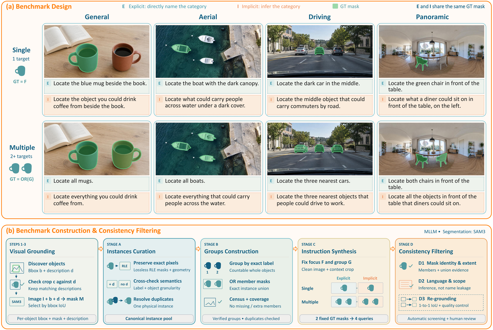
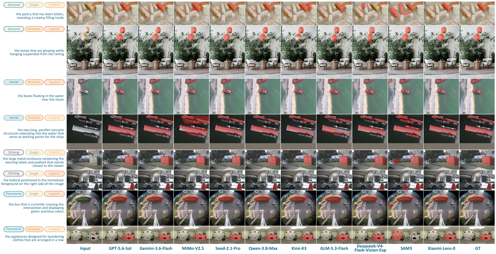

<div align="center">
<h1 align="center">Xiaomi-Lens-0</h1>
<p><b>Pixel-level grounding and visual reasoning in a compact 4B multimodal model.</b></p>
<p>
  <a href="https://seerray-lab.github.io/Xiaomi-Lens-0/"></a>
  <a href="https://arxiv.org/abs/2610.23279"></a>
  <a href="https://huggingface.co/SeerRay-Lab/Xiaomi-Lens-0"></a>
  <a href="https://modelscope.cn/models/SeerRay-Lab/Xiaomi-Lens-0"></a>
  <a href="https://github.com/SeerRay-Lab/Xiaomi-Lens-0"></a>
  <a href="https://huggingface.co/datasets/SeerRay-Lab/LensBench"></a>
  <a href="#-citation"></a>
</p>
<p><a href="#-news">News</a> · <a href="#-what-it-does">What it does</a> · <a href="#-method">Method</a> · <a href="#-showcases">Showcases</a> · <a href="#-results">Results</a> · <a href="#-quick-start">Quick Start</a> · <a href="#-citation">Citation</a></p>
<p>English | <a href="README_CN.md">简体中文</a></p>
</div>

Xiaomi-Lens-0 is a 4B multimodal large language model that learns from pixel-level supervision through a shared visual backbone. Starting from Qwen3.5-4B, it decodes each generated `<|mask|>` token into a mask with a lightweight decoder, so the same model that answers in text can point at the regions it refers to, in a final answer or in the middle of its reasoning. It improves referring comprehension over Qwen3.5-4B by 5.6 points on average across eight RefCOCO-family splits and improves scores on all eight fine-grained perception benchmarks.

https://github.com/user-attachments/assets/d7ed080d-f815-4eb5-80b0-85273974f687

*98-second overview. Also available on the [project page](https://seerray-lab.github.io/Xiaomi-Lens-0/#video) ([full-resolution MP4](docs/assets/video/xiaomi_lens_0_overview.mp4)).*

<p align="center"></p>

*Recorded outputs across the six capability domains: Referring Expression Comprehension, Referring Expression Segmentation, Multi-Instance Grounding, Reasoning Segmentation, Embodied Referring, and Fine-Grained Perception.*

## 📰 News

- The Xiaomi-Lens-0 [training code](src/xiaomi_lens/train/) is now open source, including both training stages, launch scripts, and example data. See [Training](#training) to get started.
- The [Xiaomi-Lens-0 online demo](https://huggingface.co/spaces/hugging-apps/xiaomi-lens-0) is now live on Hugging Face Spaces.
- The [Xiaomi-Lens-0](https://huggingface.co/SeerRay-Lab/Xiaomi-Lens-0) model weights and the [LensBench](https://huggingface.co/datasets/SeerRay-Lab/LensBench) benchmark dataset are now publicly available on Hugging Face.
- The [Xiaomi-Lens-0 Technical Report](https://arxiv.org/abs/2610.23279) is now publicly available on arXiv.

## ✨ What it does

1. **Referring Expression Comprehension**: finds the object a phrase describes and returns its bounding box. First on seven of eight RefCOCO, RefCOCO+, and RefCOCOg splits, 5.6 points above its Qwen3.5-4B backbone on average.
2. **Referring Expression Segmentation**: returns a pixel mask for the referred object. 81.4% mean cIoU across the eight splits, leading the compared models on every split.
3. **Multi-Instance Grounding**: lists every instance of a category, each with its own box and mask. 63.9 mean F1 on COCO 2017, highest among the compared models and 0.9 points above GroundingPI.
4. **Reasoning Segmentation**: resolves functional and implicit requests after a short reasoning trace. Best on all four ReasonSeg scores.
5. **Embodied Referring**: picks the object a person asks to be handed in cluttered scenes. Best on all four RoboRefIt scores.
6. **Fine-Grained Perception**: thinks with visual latents, grounding each region it refers to while counting or answering high-resolution questions. Improves over its Qwen3.5-4B backbone on all eight perception benchmarks, including +6.8 points on CountQA.

We also release **[LensBench](https://huggingface.co/datasets/SeerRay-Lab/LensBench)**, a segmentation benchmark with 4,800 instruction-level samples from 1,200 paired evaluation units, covering General, Aerial, Driving, and Panoramic images. Each domain contains 300 units, each with four instructions crossing Single/Multiple targets with Explicit/Implicit wording.

## 🧠 Method

Each generated `<|mask|>` token has a contextual state, or visual latent, that represents a target region given the image, instruction, and preceding response. A lightweight decoder combines this state with a single feature grid from the vision encoder before spatial merging to predict a mask. The model needs no separate segmentation encoder or multi-scale feature fusion. Joint language and mask training supervises the shared representation used for both spatial predictions and textual answers.

The same decoder supports **thinking with visual latents**: `<|mask|>` tokens placed inside the reasoning trace decode to masks for the regions the trace discusses, such as each instance being counted. Grounded reasoning traces supervise these intermediate regions. Mask decoding is an output branch, so no crops or region features are fed back to the language model.

<p align="center"></p>

Training runs in two stages: Stage 1 pretrains the mask decoder, and Stage 2 performs full-parameter supervised fine-tuning. The [project page](https://seerray-lab.github.io/Xiaomi-Lens-0/#data) shows the training data mix and the referring expression segmentation, VQA, and LensBench data pipelines.

## 🎬 Showcases

<table>
<tr>
<td width="50%"><br><sub><b>Referring Expression Segmentation</b>: “second wedge grapefruit from left to right”</sub></td>
<td width="50%"><br><sub><b>Multi-Instance Grounding</b>: “all oranges”</sub></td>
</tr>
<tr>
<td width="50%"><br><sub><b>Reasoning Segmentation</b>: “What can be squeezed onto seafood as a tangy flavor enhancer?”</sub></td>
<td width="50%"><br><sub><b>Fine-Grained Perception</b>: “How many climbing stones are there?” → 5</sub></td>
</tr>
</table>

All 24 recorded cases, four per domain, can be replayed on the [project page](https://seerray-lab.github.io/Xiaomi-Lens-0/#samples).

## 📊 Results

All scores are percentages; higher is better. **Bold** marks the best score and <u>underline</u> the second best.

<p align="center"></p>

### 1. Referring Expression Comprehension (Prec@0.5)

| Method | RefCOCO<br>Val | RefCOCO<br>TestA | RefCOCO<br>TestB | RefCOCO+<br>Val | RefCOCO+<br>TestA | RefCOCO+<br>TestB | RefCOCOg<br>Val | RefCOCOg<br>Test |
|:--|:-:|:-:|:-:|:-:|:-:|:-:|:-:|:-:|
| Grounding-DINO-L | 90.6 | 93.2 | 88.2 | 82.8 | 89.0 | 75.9 | 86.1 | 87.0 |
| Florence-2 | 93.4 | <u>95.3</u> | <u>92.0</u> | 88.3 | 92.9 | 83.6 | 91.2 | 91.7 |
| LISA<sub>LLaVA-7B</sub> | 85.4 | 88.8 | 82.6 | 74.2 | 79.5 | 68.4 | 79.3 | 80.4 |
| GSVA<sub>Vicuna-7B</sub> | 86.3 | 89.2 | 83.8 | 72.8 | 78.8 | 68.0 | 81.6 | 81.8 |
| PixelLM<sub>LLaVA-7B</sub> | 89.8 | 92.2 | 86.4 | 83.2 | 87.0 | 78.9 | 84.6 | 86.0 |
| VisionLLM v2<sub>Vicuna-7B</sub> | 87.9 | 91.2 | 84.3 | 77.6 | 83.8 | 70.2 | 82.9 | 84.1 |
| Text4Seg<sub>InternVL2-8B</sub> | 90.3 | 93.4 | 87.5 | 85.2 | 89.9 | 79.5 | 85.4 | 85.4 |
| UFO<sub>InternVL2-8B</sub> | 91.4 | 93.8 | 88.2 | 85.7 | 90.7 | 79.7 | 86.8 | 87.4 |
| MLLMSeg<sub>InternVL2.5-4B</sub> | 91.6 | 93.3 | 87.6 | 86.0 | 90.0 | 79.8 | 88.3 | 88.6 |
| InternVL-3.5<sub>4B</sub> | 92.5 | 94.3 | 88.2 | 87.6 | 92.3 | 81.6 | 89.6 | 89.3 |
| Qwen2.5-VL<sub>3B</sub> | 89.1 | 91.7 | 84.0 | 82.4 | 88.0 | 74.1 | 85.2 | 85.7 |
| Qwen3-VL<sub>4B</sub> | 90.7 | 92.2 | 86.7 | 82.9 | 89.4 | 75.6 | 87.3 | 87.7 |
| Qwen3-VL-Seg<sub>4B</sub> | 92.7 | 94.6 | 89.8 | 87.8 | 92.1 | 82.2 | 89.1 | 89.0 |
| Qwen3.5<sub>4B</sub> | 90.4 | 92.3 | 87.1 | 84.8 | 88.9 | 79.1 | 88.0 | 88.2 |
| Youtu-VL<sub>4B</sub> | <u>93.6</u> | 95.2 | 90.8 | <u>90.1</u> | <u>93.9</u> | <u>85.4</u> | <u>92.2</u> | **92.9** |
| **Xiaomi-Lens-0<sub>4B</sub>** | **94.6** | **96.2** | **92.3** | **92.1** | **94.9** | **88.5** | **92.5** | <u>92.4</u> |

### 2. Referring Expression Segmentation (cIoU)

| Method | RefCOCO<br>Val | RefCOCO<br>TestA | RefCOCO<br>TestB | RefCOCO+<br>Val | RefCOCO+<br>TestA | RefCOCO+<br>TestB | RefCOCOg<br>Val | RefCOCOg<br>Test |
|:--|:-:|:-:|:-:|:-:|:-:|:-:|:-:|:-:|
| LISA<sub>LLaVA-7B</sub> | 74.9 | 79.1 | 72.3 | 65.1 | 70.8 | 58.1 | 67.9 | 70.6 |
| GSVA<sub>Vicuna-7B</sub> | 77.2 | 78.9 | 73.5 | 65.9 | 69.6 | 59.8 | 72.7 | 73.3 |
| PixelLM<sub>LLaVA-7B</sub> | 73.0 | 76.5 | 68.2 | 66.3 | 71.7 | 58.3 | 69.3 | 70.5 |
| VisionLLM v2<sub>Vicuna-7B</sub> | 76.6 | 79.3 | 74.3 | 64.5 | 69.8 | 61.5 | 70.7 | 71.2 |
| Text4Seg<sub>InternVL2-8B</sub> | 79.2 | 81.7 | 75.6 | 72.8 | 77.9 | 66.5 | 74.0 | 75.3 |
| UFO<sub>InternVL2-8B</sub> | 78.0 | 79.7 | 75.6 | 72.3 | 76.8 | 66.6 | 73.7 | 74.3 |
| MLLMSeg<sub>InternVL2.5-4B</sub> | 79.5 | 81.4 | 77.7 | 75.4 | 78.7 | 70.8 | 78.1 | <u>78.4</u> |
| SAM 3 | 75.5 | 77.6 | 71.0 | 67.3 | 71.1 | 63.4 | 73.4 | 74.0 |
| UniPixel<sub>Qwen2.5-VL-3B</sub> | 80.5 | 82.6 | 76.9 | 74.3 | 78.9 | 68.4 | 76.3 | 77.0 |
| Youtu-VL<sub>4B</sub> | 80.7 | 82.0 | 78.4 | <u>76.2</u> | 79.6 | <u>71.4</u> | 76.5 | 76.6 |
| Qwen3-VL-Seg<sub>4B</sub> | <u>82.3</u> | <u>83.7</u> | <u>79.1</u> | <u>76.2</u> | <u>80.2</u> | 70.8 | <u>78.2</u> | 78.1 |
| **Xiaomi-Lens-0<sub>4B</sub>** | **83.4** | **84.6** | **81.2** | **79.9** | **83.3** | **76.3** | **81.1** | **81.2** |

### 3. Multi-Instance Grounding (COCO 2017)

Recall, precision, and F1 at IoU 0.50 and 0.95; the mIoU group averages each metric over IoU thresholds from 0.50 to 0.95.

| Method | IoU 0.50<br>Recall | IoU 0.50<br>Precision | IoU 0.50<br>F1 | IoU 0.95<br>Recall | IoU 0.95<br>Precision | IoU 0.95<br>F1 | mIoU<br>Recall | mIoU<br>Precision | mIoU<br>F1 |
|:--|:-:|:-:|:-:|:-:|:-:|:-:|:-:|:-:|:-:|
| GroundingDINO | <u>79.6</u> | **83.2** | **81.4** | 24.7 | 28.1 | 26.3 | 61.1 | 63.7 | 60.6 |
| Rex-Omni | 69.9 | 81.0 | 75.0 | 17.9 | 21.7 | 19.7 | 53.9 | 59.4 | 56.3 |
| LocateAnything Fast | 66.2 | 73.3 | 69.6 | 24.7 | 26.9 | 25.8 | 50.9 | 59.3 | 53.1 |
| LocateAnything Hybrid | 74.7 | 80.8 | 77.6 | <u>26.6</u> | <u>28.7</u> | <u>27.6</u> | 52.4 | **65.2** | 59.1 |
| LocateAnything Slow NTP | 75.0 | <u>81.9</u> | 78.3 | 25.0 | 27.2 | 26.0 | 54.7 | <u>65.1</u> | 59.4 |
| Qwen2.5-VL<sub>7B</sub> | 57.2 | 62.9 | 59.9 | 12.2 | 13.2 | 12.7 | 44.7 | 49.1 | 46.3 |
| Qwen3-VL<sub>2B</sub> | 63.5 | 67.1 | 65.3 | 21.8 | 22.6 | 22.2 | 42.6 | 44.9 | 42.5 |
| Qwen3-VL<sub>4B</sub> | 66.1 | 70.6 | 68.3 | 23.7 | 24.9 | 24.3 | 44.9 | 47.8 | 46.5 |
| Qwen3-VL<sub>8B</sub> | 65.7 | 69.5 | 67.5 | 23.9 | 25.1 | 24.5 | 44.8 | 47.3 | 46.3 |
| RynnBrain1.1 | 36.5 | 60.5 | 45.5 | 11.6 | 16.5 | 13.6 | 28.7 | 45.3 | 35.2 |
| SenseNova-Vision | 79.1 | 80.5 | 79.8 | **27.2** | **30.2** | **28.6** | 63.1 | 55.4 | 57.5 |
| GroundingPI | **81.4** | 80.9 | <u>81.2</u> | 22.9 | 22.8 | 22.8 | <u>63.2</u> | 62.8 | <u>63.0</u> |
| MiMo-VL-SFT<sub>7B</sub> | 65.5 | 72.2 | 68.7 | 10.0 | 11.1 | 10.5 | 45.7 | 50.5 | 48.0 |
| MiMo-VL-RL<sub>7B</sub> | 65.6 | 74.5 | 69.8 | 9.2 | 10.3 | 9.7 | 44.5 | 50.2 | 47.2 |
| BAGEL | 65.6 | 75.2 | 70.1 | 11.0 | 13.0 | 11.9 | 46.3 | 47.2 | 46.0 |
| RynnBrain | 21.3 | 49.9 | 29.8 | 4.9 | 10.9 | 6.7 | 15.5 | 35.4 | 21.5 |
| **Xiaomi-Lens-0<sub>4B</sub>** | <u>79.6</u> | 81.1 | 80.4 | **27.2** | 27.7 | 27.4 | **63.4** | 64.5 | **63.9** |

### 4. Reasoning Segmentation (ReasonSeg, gIoU / cIoU)

| Method | ReasonSeg<br>Val<br>gIoU | ReasonSeg<br>Val<br>cIoU | ReasonSeg<br>Test<br>gIoU | ReasonSeg<br>Test<br>cIoU |
|:--|:-:|:-:|:-:|:-:|
| LISA<sub>LLaVA-7B</sub> | 52.9 | 54.0 | 47.3 | 48.4 |
| LISA++<sub>LLaVA-7B</sub> | 64.2 | <u>68.1</u> | 57.0 | 59.5 |
| PixelLM<sub>LLaVA-7B</sub> | 44.7 | 37.4 | 44.0 | 39.7 |
| Sa2VA<sub>InternVL2-2B</sub> | 59.2 | 60.0 | 56.9 | 55.8 |
| Sa2VA<sub>InternVL2-8B</sub> | <u>65.2</u> | 61.1 | 59.5 | 57.8 |
| X-SAM<sub>Phi-3-3.8B</sub> | 56.6 | 32.9 | 57.8 | 41.0 |
| InstructSAM<sub>Qwen3-VL-2B</sub> | 62.5 | 65.0 | <u>61.1</u> | <u>61.0</u> |
| **Xiaomi-Lens-0<sub>4B</sub>** | **71.2** | **68.5** | **68.0** | **62.5** |

### 5. Embodied Referring (RoboRefIt, gIoU / cIoU)

| Method | RoboRefIt<br>TestA<br>gIoU | RoboRefIt<br>TestA<br>cIoU | RoboRefIt<br>TestB<br>gIoU | RoboRefIt<br>TestB<br>cIoU |
|:--|:-:|:-:|:-:|:-:|
| LISA<sub>LLaVA-7B</sub> | 36.1 | 29.9 | 28.7 | 22.7 |
| LISA++<sub>LLaVA-7B</sub> | 58.7 | 51.5 | 53.5 | 47.8 |
| PixelLM<sub>LLaVA-7B</sub> | 45.2 | 38.4 | 38.2 | 31.4 |
| Sa2VA<sub>InternVL2-2B</sub> | 56.8 | 29.0 | 34.0 | 10.2 |
| Sa2VA<sub>InternVL2-8B</sub> | 58.7 | 27.9 | 36.1 | 9.0 |
| X-SAM<sub>Phi-3-3.8B</sub> | 41.2 | 10.3 | 25.1 | 4.0 |
| InstructSAM<sub>Qwen3-VL-2B</sub> | <u>82.5</u> | <u>58.4</u> | <u>74.4</u> | <u>55.5</u> |
| **Xiaomi-Lens-0<sub>4B</sub>** | **87.0** | **88.4** | **81.5** | **81.2** |

### 6. Fine-Grained Perception (accuracy)

| Method | General Perception<br>MME-RW-en | General Perception<br>MME-RW-cn | General Perception<br>CV-B | High-Resolution Perception<br>V* | High-Resolution Perception<br>HR-4K | High-Resolution Perception<br>HR-8K | Counting and Color<br>CountQA | Counting and Color<br>ColorB |
|:--|:-:|:-:|:-:|:-:|:-:|:-:|:-:|:-:|
| Qwen2.5-VL<sub>7B</sub> | 60.8 | 58.3 | 75.3 | 78.5 | 71.6 | 67.9 | 18.9 | 76.4 |
| MiMo-VL-RL<sub>7B</sub> | 63.4 | 59.8 | 84.3 | 81.2 | 74.4 | 72.9 | 28.3 | <u>82.8</u> |
| Qwen3-VL<sub>4B</sub> | 63.5 | 63.6 | 85.0 | 80.1 | 78.3 | 72.9 | 28.1 | 81.6 |
| Qwen3-VL<sub>8B</sub> | 66.0 | <u>66.7</u> | <u>85.4</u> | <u>86.4</u> | 78.9 | 74.6 | 29.0 | <u>82.8</u> |
| MiniCPM-V-4.5<sub>9B</sub> | 58.2 | 56.2 | 80.2 | 70.2 | 69.9 | 63.6 | 23.4 | 79.8 |
| Qwen3.5<sub>4B</sub> | <u>66.5</u> | 60.3 | <u>85.4</u> | 82.2 | <u>81.5</u> | <u>75.6</u> | <u>43.8</u> | 82.7 |
| **Xiaomi-Lens-0<sub>4B</sub>** | **69.7** | **67.5** | **88.1** | **87.4** | **82.5** | **80.6** | **50.6** | **84.4** |

Box-grounding F1 on the RefCOCO family is on the [project page](https://seerray-lab.github.io/Xiaomi-Lens-0/#results).

### 7. LensBench

LensBench contains 1,200 human-reviewed paired units and 4,800 instructions across general, aerial, driving, and panoramic imagery (300 units per domain). Each unit combines single/multiple targets with explicit/implicit wording. The two wordings share the same target mask; multiple targets use the union mask and its enclosing box. Targets and masks are fixed before instruction synthesis, followed by automated consistency checks and human review of each complete unit.

GPT-6-Astra leads cIoU on explicit and implicit instructions and in aerial, driving, and panoramic imagery. Qwen3.8-Max leads cIoU in general imagery (74.2). Xiaomi-Lens-0 ranks second on both explicit-instruction metrics and on cIoU in aerial, driving, and panoramic imagery, and leads aerial Prec@0.5 (79.6). Implicit instructions remain challenging: cIoU drops from 71.4 to 54.7, while Prec@0.5 drops from 85.0 to 70.0. The gap is largest for multiple targets in panoramic scenes, where cIoU falls from 71.8 to 48.9 and Prec@0.5 from 81.3 to 48.7.

Marginal results pool single and multiple targets. Each cell reports cIoU / Prec@0.5 (%, higher is better).

| Method | Explicit | Implicit | General | Aerial | Driving | Panoramic |
|:--| :-: | :-: | :-: | :-: | :-: | :-: |
| GPT-6-Astra | **72.6** / **86.3** | **71.0** / **84.0** | <u>74.1</u> / **86.2** | **61.7** / <u>76.9</u> | **77.6** / **89.0** | **68.9** / **88.3** |
| GPT-5.6-Sol | 63.8 / 73.2 | 61.2 / 70.0 | 68.4 / 67.9 | 42.2 / 58.5 | 68.4 / <u>81.8</u> | 57.1 / 78.3 |
| Gemini-3.6-Flash | 61.4 / 74.5 | 61.0 / <u>70.3</u> | 63.6 / 65.8 | 50.1 / 62.5 | 66.8 / 81.0 | 60.8 / <u>80.3</u> |
| MiMo-V2.5 | 51.4 / 52.2 | 47.4 / 46.8 | 54.2 / 45.2 | 32.6 / 38.6 | 50.5 / 52.8 | 45.4 / 61.4 |
| Seed-2.1-Pro | 62.1 / 70.2 | 55.9 / 64.5 | 60.6 / 56.7 | 50.1 / 58.5 | 66.8 / 77.4 | 59.9 / 76.7 |
| Qwen3.8-Max | 67.6 / 69.2 | <u>64.5</u> / 63.8 | **74.2** / <u>79.7</u> | 33.5 / 62.5 | 58.0 / 57.7 | 60.8 / 66.2 |
| Kimi-K3 | 29.4 / 39.1 | 28.3 / 33.0 | 38.5 / 26.1 | 13.8 / 44.9 | 47.2 / 31.1 | 13.4 / 42.1 |
| GLM-5.3-Flash | 44.3 / 37.5 | 43.5 / 33.3 | 48.9 / 26.3 | 28.0 / 33.4 | 51.6 / 47.5 | 30.6 / 34.4 |
| DeepSeek-V4-Flash-Vision-Exp | 41.8 / 30.7 | 41.1 / 27.3 | 46.1 / 28.1 | 25.9 / 28.9 | 43.9 / 27.9 | 32.8 / 31.0 |
| SAM 3 | 17.3 / 38.1 | 15.4 / 19.5 | 23.8 / 24.8 | 4.3 / 27.3 | 27.7 / 35.1 | 11.1 / 27.9 |
| **Xiaomi-Lens-0<sub>4B</sub>** | <u>71.4</u> / <u>85.0</u> | 54.7 / 70.0 | 63.9 / 79.1 | <u>57.1</u> / **79.6** | <u>68.6</u> / 79.4 | <u>62.3</u> / 72.1 |

<p align="center"></p>

<details>
<summary>LensBench qualitative comparisons</summary>

<p align="center"><a href="docs/assets/figures/lensbench_evaluation.png"></a></p>

</details>

## 🚀 Quick Start

### Installation

```bash
git clone https://github.com/SeerRay-Lab/Xiaomi-Lens-0.git
cd Xiaomi-Lens-0
pip install -r requirements.txt   # torch, transformers 5.4, flash-attn
pip install -e .
```

Inference needs a CUDA GPU (bf16, FlashAttention-2). The commands below load the weights from [Hugging Face](https://huggingface.co/SeerRay-Lab/Xiaomi-Lens-0) as `SeerRay-Lab/Xiaomi-Lens-0`; pass a local directory to use a downloaded copy.

### Inference with Transformers

```bash
python infer.py \
  --checkpoint SeerRay-Lab/Xiaomi-Lens-0 \
  --image /path/to/image.jpg \
  --text 'Locate all instances in the image that match the description "the cat on the left". Report bbox coordinates and masks.' \
  --output result.jpg --draw-bbox
```

The script prints the generated text and saves the masks (and, with `--draw-bbox`, the boxes) overlaid on the image. Useful options:

- `--per-mask-output`: save one image per predicted mask instead of a single composite.
- `--mask-threshold`: sigmoid threshold for binarizing masks (default 0.5; 0 draws a soft heatmap).
- `--temperature`, `--top-p`: sample instead of decoding greedily.

Each grounded instance in the answer is written as `<bbox>[x1, y1, x2, y2]</bbox><mask><|mask|></mask>`, with box coordinates normalized to 0–1000. Every `<|mask|>` token is decoded into a pixel mask at the resolution the vision encoder sees. Masks emitted inside `<think>` ground the reasoning and are not part of the final answer.

<details>
<summary>Python API</summary>

```python
import torch
from PIL import Image
from infer import (
    build_inputs, generate_completion, load_model_and_processor,
    run_forward, split_answer_content, parse_answer_bboxes,
)

device = torch.device("cuda")
model, processor, mask_token_id = load_model_and_processor("SeerRay-Lab/Xiaomi-Lens-0", device)

image = Image.open("/path/to/image.jpg").convert("RGB")
text = ('Locate all instances in the image that match the description '
        '"the cat on the left". Report bbox coordinates and masks.')
inputs, _ = build_inputs(processor, image, text, device)

# Phase 1: generate text with <bbox> and <|mask|> tokens.
completion_ids, completion, num_masks = generate_completion(
    model, processor, inputs, max_new_tokens=2048, mask_token_id=mask_token_id)
print(completion)

# Phase 2: decode each <|mask|> into a mask; keep only those in the final answer.
if num_masks > 0:
    _, num_thought_masks = split_answer_content(completion)
    mask_logits = run_forward(model, inputs, completion_ids, mask_token_id, device)
    masks = mask_logits[:, num_thought_masks:].sigmoid() > 0.5   # (1, K, H, W)
    boxes = parse_answer_bboxes(completion)                       # [[x1, y1, x2, y2], ...] in 0–1000
```

The masks are aligned with the image resized to the vision encoder's input canvas; `visualize_pixel_mask` in `infer` shows how to overlay them on the original image.

</details>

### Serving with vLLM

Serving uses two vLLM processes on the same checkpoint: one generates text, and one runs the mask decoder through vLLM's pooling API. Install the vLLM extra in a separate environment (tested with vLLM 0.19.1):

```bash
pip install -e ".[vllm]"

# Terminal 1: text generation on :8000
bash src/xiaomi_lens/integrations/vllm/run_vllm.sh SeerRay-Lab/Xiaomi-Lens-0

# Terminal 2: mask decoding on :8001
bash src/xiaomi_lens/integrations/vllm/run_vllm_mask.sh SeerRay-Lab/Xiaomi-Lens-0

# Terminal 3: query both and save the overlay
python -m xiaomi_lens.integrations.vllm.client \
  --image /path/to/image.jpg --query "the cat on the left" --output result.png
```

The client sends the image path to the mask server, so it must run on the same machine as the servers. Ports and the served model name can be changed with `PORT` and `SERVED_NAME`; if you override `MAX_PIXELS`, set the same value for both servers.

### LensBench

LensBench is available on [Hugging Face Datasets](https://huggingface.co/datasets/SeerRay-Lab/LensBench). Download it with:

```bash
hf download SeerRay-Lab/LensBench --repo-type dataset --local-dir LensBench
```

Evaluate with `eval/run.py`. By default it loads `SeerRay-Lab/Xiaomi-Lens-0` and `SeerRay-Lab/LensBench` from Hugging Face; `--model-path` and `--dataset-path` also accept a local checkpoint directory and a local `test.parquet` (or its directory).

```bash
pip install -e ".[eval]"

# Single GPU
python eval/run.py --output-dir outputs/lensbench

# One shard per GPU, merged at the end
python eval/run.py --devices cuda:0 cuda:1 cuda:2 cuda:3 --output-dir outputs/lensbench

# Local copies
python eval/run.py --model-path /path/to/Xiaomi-Lens-0 --dataset-path LensBench --output-dir outputs/lensbench

# vLLM backend (text and mask engines on two GPUs; requires ".[vllm]")
python eval/run.py --backend vllm --vllm-text-device cuda:0 --vllm-mask-device cuda:1 --output-dir outputs/lensbench_vllm
```

Results are written to `metrics.json` (Prec@0.5, cIoU and gIoU, overall and per domain, explicitness and cardinality) and per-sample predictions to `predictions.jsonl`. Add `--resume` to continue an interrupted run and `--limit N` for a quick check.

### Training

Training starts from Qwen3.5 in two stages. Stage 1 trains the mask decoder and the `<|mask|>` embedding with mask loss alone, keeping the rest of the model frozen. Stage 2 fine-tunes all parameters with the LM loss plus the mask loss (dice + BCE). The launchers use DeepSpeed (ZeRO-1 for Stage 1, ZeRO-2 for Stage 2) and expect CUDA GPUs.

```bash
pip install -e ".[train]"        # transformers 5.4, deepspeed, accelerate
pip install -e ".[train-fast]"   # optional: liger-kernel and Qwen3.5 linear-attention kernels

# Prepare the base model: rename Qwen's box tokens to <bbox>/</bbox> (IDs and weights unchanged)
hf download Qwen/Qwen3.5-4B --local-dir checkpoints/Qwen3.5-4B
python tools/prepare_base_model.py checkpoints/Qwen3.5-4B --in-place

# Optional: synthetic toy data to check the setup end to end
python examples/train/make_toy_data.py --output examples/train/toy

# Stage 1 → checkpoints/xiaomi-lens-stage1
MODEL_PATH=checkpoints/Qwen3.5-4B DATA_CONFIG=examples/train/stage1.yaml \
  bash scripts/train_stage1.sh

# Stage 2 → checkpoints/xiaomi-lens-stage2 (starts from the Stage 1 output)
DATA_CONFIG=examples/train/stage2.yaml bash scripts/train_stage2.sh
```

Training data is JSONL listed in a YAML manifest. Each `<|mask|>` in an assistant turn is paired with one COCO RLE mask; [`examples/train/README.md`](examples/train/README.md) describes the format. Arguments appended to a launcher override its defaults (`python train.py --help` lists them all). For multi-node training, run the launcher on every node with `NNODES`, `NODE_RANK`, and `MASTER_ADDR` set. Both launchers resume from the latest `checkpoint-*` in `OUTPUT_DIR` with the same world size and ZeRO stage. The output loads with `infer.py`, `eval/run.py`, and the vLLM servers.

## 📝 Citation

If you find Xiaomi-Lens-0 useful, please cite:

```bibtex
@misc{xiaomilens0,
  title         = {Xiaomi-Lens-0 Technical Report},
  author        = {Pei Fu and Yike Liu and Yue Sun and Hanmo Wang and
                   Xiuwen Xi and Ruoceng Zhang and Shaojie Zhang and Tingwei Huang and
                   Chao Jiang and Hang Li and Bingrui Liu and Zhenbo Luo and
                   Heng Qu and Changjian Xu and Ming Xu and Jian Luan},
  year          = {2026},
  eprint        = {2610.23279},
  archivePrefix = {arXiv},
  primaryClass  = {cs.CV},
  url           = {https://arxiv.org/abs/2610.23279}
}
```

## 🙏 Acknowledgements

Xiaomi-Lens-0 is built on [Qwen3.5](https://github.com/QwenLM).

We thank [InstructSAM](https://github.com/ZJU4EmbodiedAI/InstructSAM) for their open-source contributions.

Code is licensed under [Apache-2.0](LICENSE).
