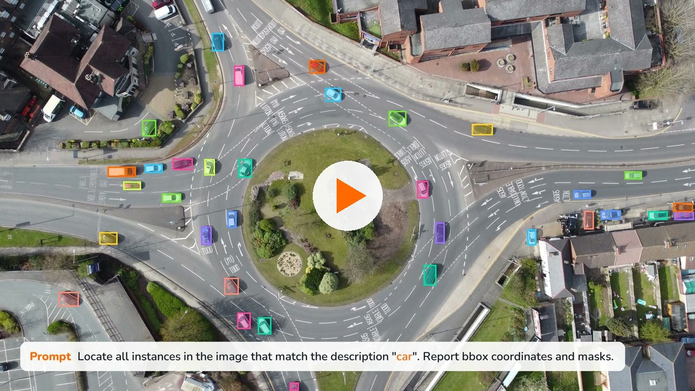
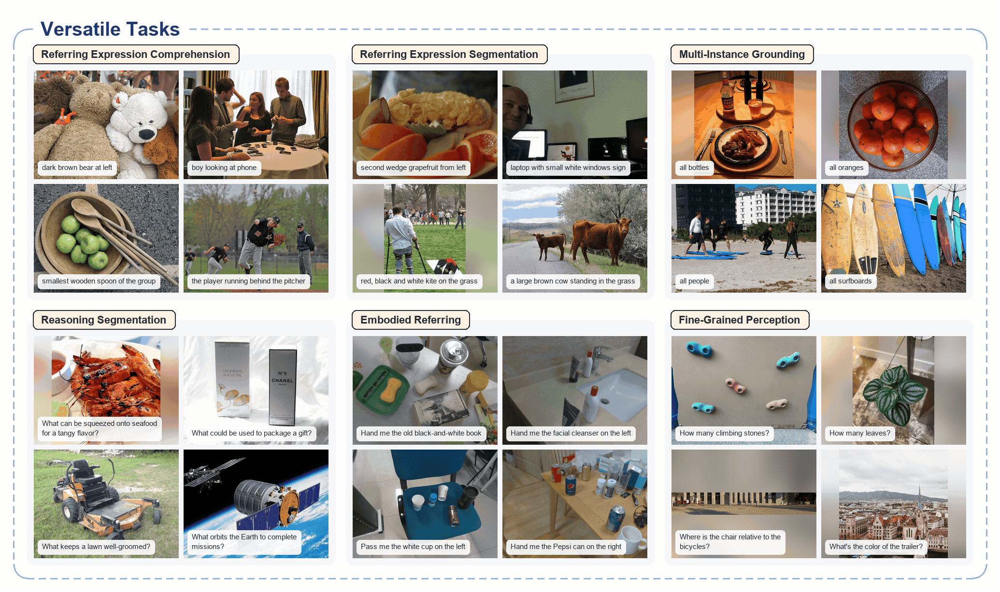
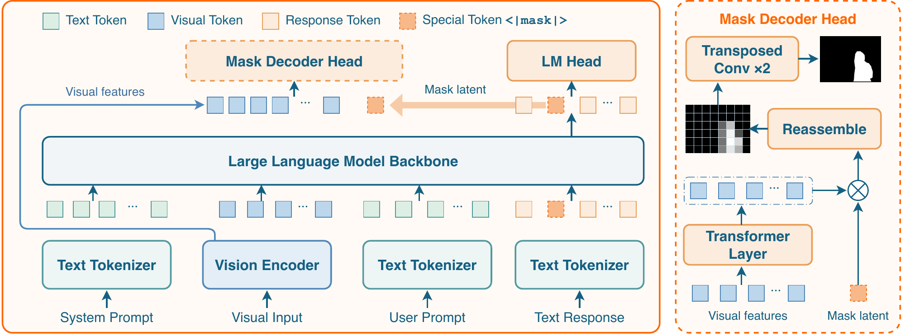
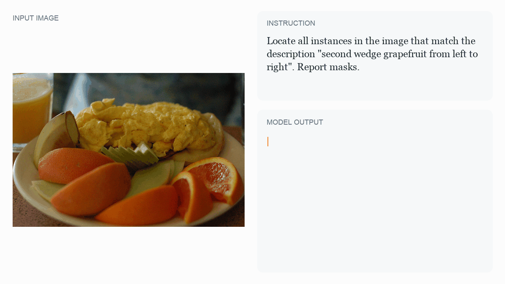
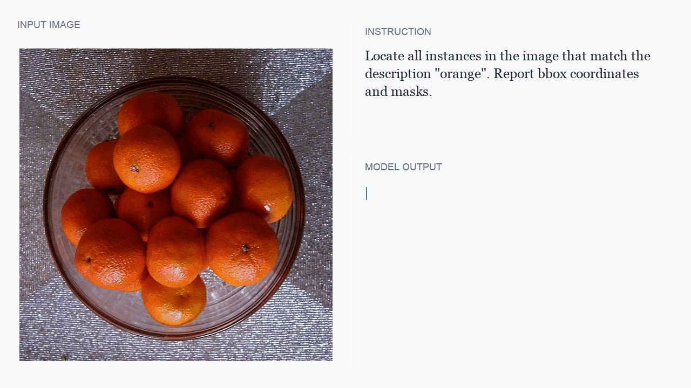
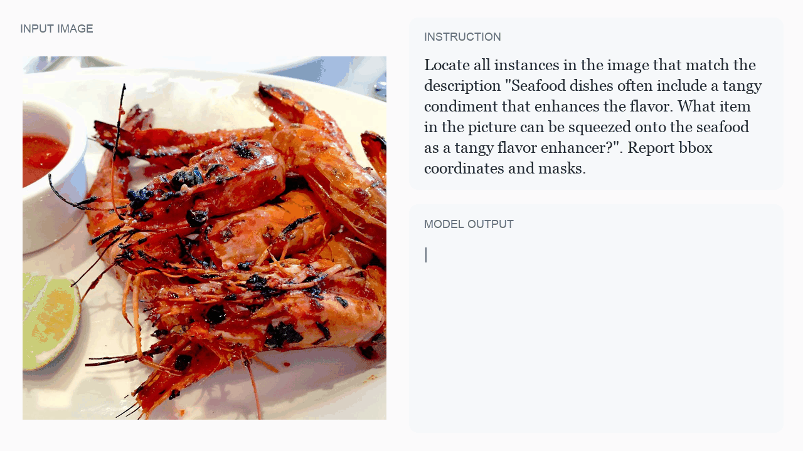
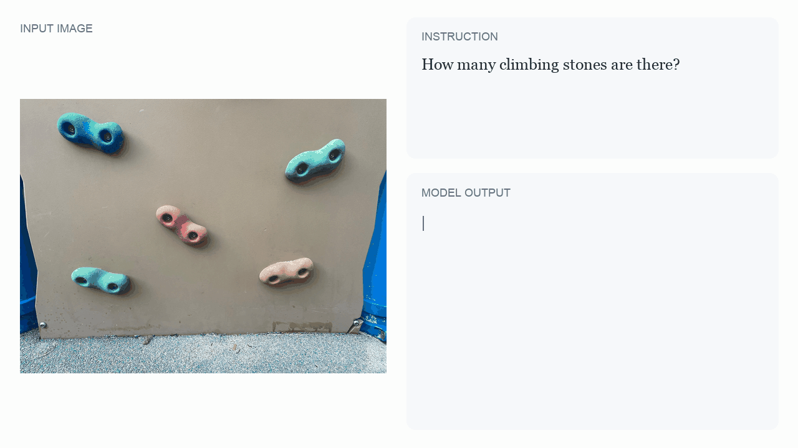
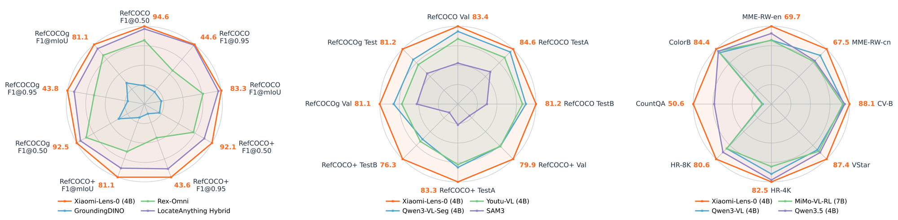

<div align="center">
<h1 align="center">Xiaomi-Lens-0</h1>
<p><b>在紧凑的 4B 多模态模型中实现像素级定位与视觉推理。</b></p>
<p>
  <a href="https://seerray-lab.github.io/Xiaomi-Lens-0/"></a>
  <a href="https://huggingface.co/SeerRay-Lab/Xiaomi-Lens-0"></a>
  <a href="https://github.com/SeerRay-Lab/Xiaomi-Lens-0"></a>
  <a href="https://huggingface.co/datasets/SeerRay-Lab/LensBench"></a>
  <a href="#-引用"></a>
</p>
<p><a href="#-最新动态">最新动态</a> · <a href="#-核心能力">核心能力</a> · <a href="#-方法介绍">方法介绍</a> · <a href="#-示例展示">示例展示</a> · <a href="#-评测结果">评测结果</a> · <a href="#-快速开始">快速开始</a> · <a href="#-引用">引用</a></p>
<p><a href="README.md">English</a> | 简体中文</p>
</div>

Xiaomi-Lens-0 是一个 4B 多模态大语言模型，通过像素级监督学习共享视觉骨干网络。模型基于 Qwen3.5-4B，使用轻量级解码器将每个生成的 `<|mask|>` token 解码为分割掩码，让模型在输出文字回答的同时，也能在最终答案或推理过程中指出所描述的图像区域。

<p align="center"><a href="https://seerray-lab.github.io/Xiaomi-Lens-0/#video"></a></p>

*▶ [观看 98 秒概览视频](https://seerray-lab.github.io/Xiaomi-Lens-0/#video)（[MP4](docs/assets/video/xiaomi_lens_0_overview.mp4)）*

<p align="center"></p>

*六类能力的输出回放：指代表达理解、指代表达分割、多实例定位、推理分割、具身指代与细粒度感知。*

## 📰 最新动态

- **2026-10**：本仓库包含 Transformers 与 vLLM 推理代码、静态项目主页，以及覆盖六类能力的录制示例。

发布状态（2026-10-15）：模型和 LensBench 链接目前需要访问权限（HTTP 401），线上项目主页尚不可用（HTTP 404）。下文下载命令需要对应仓库的访问权限。可运行 `python3 -m http.server 8000 -d docs` 在本地预览主页。

## ✨ 核心能力

1. **指代表达理解**：根据自然语言描述找到目标物体并返回边界框。在 RefCOCO、RefCOCO+ 和 RefCOCOg 的八个数据划分中，七个排名第一。
2. **指代表达分割**：为被指代的目标物体生成像素级掩码。八个数据划分的平均 cIoU 为 81.4%，在每个划分上均优于所比较的模型。
3. **多实例定位**：找出指定类别的所有实例，为每个实例输出边界框和掩码。在 COCO 2017 上的平均 F1 为 60.6，仅次于 GroundingPI（63.0）。
4. **推理分割**：通过简短推理理解基于功能或隐含意图的请求，并分割相应目标。在 ReasonSeg 的四项指标上均取得最佳结果。
5. **具身指代**：在杂乱场景中识别人希望被递交的物体。在 RoboRefIt 的四项指标上均取得最佳结果。
6. **细粒度感知**：借助视觉潜变量进行推理，在计数或回答高分辨率图像问题时定位所涉及的区域。在全部八项感知基准上均优于基础模型 Qwen3.5-4B，其中 CountQA 提升 6.8 个百分点。

我们还开源了 **[LensBench](https://huggingface.co/datasets/SeerRay-Lab/LensBench)**，一个包含 8,000 个样本的分割评测基准，覆盖通用、航拍、驾驶和全景图像，并包含显式与隐式指令。

## 🧠 方法介绍

每个生成的 `<|mask|>` token 都对应一个上下文状态，即视觉潜变量，根据图像、指令和前文回答表示目标区域。轻量级解码器将该状态与视觉编码器在空间合并前输出的单一特征网格结合，预测分割掩码。模型无需独立的分割编码器或多尺度特征融合。语言与掩码的联合训练对共享表示施加监督，使其同时用于空间预测和文字回答。

<p align="center"></p>

训练分为两个阶段：第一阶段预训练掩码解码器，第二阶段进行全参数监督微调。[项目主页](https://seerray-lab.github.io/Xiaomi-Lens-0/#data)展示了训练数据构成，以及指代表达分割、视觉问答（VQA）和 LensBench 的数据处理流程。

## 🎬 示例展示

<table>
<tr>
<td width="50%"><br><sub><b>指代表达分割</b>：“从左往右第二块西柚”</sub></td>
<td width="50%"><br><sub><b>多实例定位</b>：“所有橙子”</sub></td>
</tr>
<tr>
<td width="50%"><br><sub><b>推理分割</b>：“什么东西可以挤汁淋在海鲜上，为其增添酸味？”</sub></td>
<td width="50%"><br><sub><b>细粒度感知</b>：“有多少块攀岩石？” → 5</sub></td>
</tr>
</table>

全部 24 个案例（每类能力各 4 个）均可在[项目主页](https://seerray-lab.github.io/Xiaomi-Lens-0/#samples)回放。

## 📊 评测结果

所有分数均以百分比表示，数值越高越好。**粗体**表示最佳结果，<u>下划线</u>表示次优结果。

<p align="center"></p>

### 1. 指代表达理解（Pres@0.5）

| 方法 | RefCOCO<br>Val | RefCOCO<br>TestA | RefCOCO<br>TestB | RefCOCO+<br>Val | RefCOCO+<br>TestA | RefCOCO+<br>TestB | RefCOCOg<br>Val | RefCOCOg<br>Test |
|:--|:-:|:-:|:-:|:-:|:-:|:-:|:-:|:-:|
| Grounding-DINO-L | 90.6 | 93.2 | 88.2 | 82.8 | 89.0 | 75.9 | 86.1 | 87.0 |
| Florence-2 | 93.4 | <u>95.3</u> | <u>92.0</u> | 88.3 | 92.9 | 83.6 | 91.2 | 91.7 |
| LISA<sub>LLaVA-7B</sub> | 85.4 | 88.8 | 82.6 | 74.2 | 79.5 | 68.4 | 79.3 | 80.4 |
| GSVA<sub>Vicuna-7B</sub> | 86.3 | 89.2 | 83.8 | 72.8 | 78.8 | 68.0 | 81.6 | 81.8 |
| PixelLM<sub>LLaVA-7B</sub> | 89.8 | 92.2 | 86.4 | 83.2 | 87.0 | 78.9 | 84.6 | 86.0 |
| VisionLLM v2<sub>Vicuna-7B</sub> | 87.9 | 91.2 | 84.3 | 77.6 | 83.8 | 70.2 | 82.9 | 84.1 |
| Text4Seg<sub>InternVL2-8B</sub> | 90.3 | 93.4 | 87.5 | 85.2 | 89.9 | 79.5 | 85.4 | 85.4 |
| UFO<sub>InternVL2-8B</sub> | 91.4 | 93.8 | 88.2 | 85.7 | 90.7 | 79.7 | 86.8 | 87.4 |
| MLLMSeg<sub>InternVL2.5-4B</sub> | 91.6 | 93.3 | 87.6 | 86.0 | 90.0 | 79.8 | 88.3 | 88.6 |
| InternVL-3.5<sub>4B</sub> | 92.5 | 94.3 | 88.2 | 87.6 | 92.3 | 81.6 | 89.6 | 89.3 |
| Qwen2.5-VL<sub>3B</sub> | 89.1 | 91.7 | 84.0 | 82.4 | 88.0 | 74.1 | 85.2 | 85.7 |
| Qwen3-VL<sub>4B</sub> | 90.7 | 92.2 | 86.7 | 82.9 | 89.4 | 75.6 | 87.3 | 87.7 |
| Qwen3-VL-Seg<sub>4B</sub> | 92.7 | 94.6 | 89.8 | 87.8 | 92.1 | 82.2 | 89.1 | 89.0 |
| Qwen3.5<sub>4B</sub> | 90.4 | 92.3 | 87.1 | 84.8 | 88.9 | 79.1 | 88.0 | 88.2 |
| Youtu-VL<sub>4B</sub> | <u>93.6</u> | 95.2 | 90.8 | <u>90.1</u> | <u>93.9</u> | <u>85.4</u> | <u>92.2</u> | **92.9** |
| **Xiaomi-Lens-0<sub>4B</sub>** | **94.6** | **96.2** | **92.3** | **92.1** | **94.9** | **88.5** | **92.5** | <u>92.4</u> |

### 2. 指代表达分割（cIoU）

| 方法 | RefCOCO<br>Val | RefCOCO<br>TestA | RefCOCO<br>TestB | RefCOCO+<br>Val | RefCOCO+<br>TestA | RefCOCO+<br>TestB | RefCOCOg<br>Val | RefCOCOg<br>Test |
|:--|:-:|:-:|:-:|:-:|:-:|:-:|:-:|:-:|
| LISA<sub>LLaVA-7B</sub> | 74.9 | 79.1 | 72.3 | 65.1 | 70.8 | 58.1 | 67.9 | 70.6 |
| GSVA<sub>Vicuna-7B</sub> | 77.2 | 78.9 | 73.5 | 65.9 | 69.6 | 59.8 | 72.7 | 73.3 |
| PixelLM<sub>LLaVA-7B</sub> | 73.0 | 76.5 | 68.2 | 66.3 | 71.7 | 58.3 | 69.3 | 70.5 |
| VisionLLM v2<sub>Vicuna-7B</sub> | 76.6 | 79.3 | 74.3 | 64.5 | 69.8 | 61.5 | 70.7 | 71.2 |
| Text4Seg<sub>InternVL2-8B</sub> | 79.2 | 81.7 | 75.6 | 72.8 | 77.9 | 66.5 | 74.0 | 75.3 |
| UFO<sub>InternVL2-8B</sub> | 78.0 | 79.7 | 75.6 | 72.3 | 76.8 | 66.6 | 73.7 | 74.3 |
| MLLMSeg<sub>InternVL2.5-4B</sub> | 79.5 | 81.4 | 77.7 | 75.4 | 78.7 | 70.8 | 78.1 | <u>78.4</u> |
| SAM 3 | 75.5 | 77.6 | 71.0 | 67.3 | 71.1 | 63.4 | 73.4 | 74.0 |
| UniPixel<sub>Qwen2.5-VL-3B</sub> | 80.5 | 82.6 | 76.9 | 74.3 | 78.9 | 68.4 | 76.3 | 77.0 |
| Youtu-VL<sub>4B</sub> | 80.7 | 82.0 | 78.4 | <u>76.2</u> | 79.6 | <u>71.4</u> | 76.5 | 76.6 |
| Qwen3-VL-Seg<sub>4B</sub> | <u>82.3</u> | <u>83.7</u> | <u>79.1</u> | <u>76.2</u> | <u>80.2</u> | 70.8 | <u>78.2</u> | 78.1 |
| **Xiaomi-Lens-0<sub>4B</sub>** | **83.4** | **84.6** | **81.2** | **79.9** | **83.3** | **76.3** | **81.1** | **81.2** |

### 3. 多实例定位（COCO 2017）

报告 IoU 阈值为 0.50 和 0.95 时的召回率、精确率及 F1；mIoU 分组中的各项指标在 0.50 至 0.95 的 IoU 阈值范围内取平均。

| 方法 | IoU 0.50<br>召回率 | IoU 0.50<br>精确率 | IoU 0.50<br>F1 | IoU 0.95<br>召回率 | IoU 0.95<br>精确率 | IoU 0.95<br>F1 | mIoU<br>召回率 | mIoU<br>精确率 | mIoU<br>F1 |
|:--|:-:|:-:|:-:|:-:|:-:|:-:|:-:|:-:|:-:|
| GroundingDINO | <u>79.6</u> | **83.2** | **81.4** | 24.7 | 28.1 | 26.3 | 61.1 | 63.7 | <u>60.6</u> |
| Rex-Omni | 69.9 | 81.0 | 75.0 | 17.9 | 21.7 | 19.7 | 53.9 | 59.4 | 56.3 |
| LocateAnything Fast | 66.2 | 73.3 | 69.6 | 24.7 | 26.9 | 25.8 | 50.9 | 59.3 | 53.1 |
| LocateAnything Hybrid | 74.7 | 80.8 | 77.6 | <u>26.6</u> | <u>28.7</u> | <u>27.6</u> | 52.4 | **65.2** | 59.1 |
| LocateAnything Slow NTP | 75.0 | <u>81.9</u> | 78.3 | 25.0 | 27.2 | 26.0 | 54.7 | <u>65.1</u> | 59.4 |
| Qwen2.5-VL<sub>7B</sub> | 57.2 | 62.9 | 59.9 | 12.2 | 13.2 | 12.7 | 44.7 | 49.1 | 46.3 |
| Qwen3-VL<sub>2B</sub> | 63.5 | 67.1 | 65.3 | 21.8 | 22.6 | 22.2 | 42.6 | 44.9 | 42.5 |
| Qwen3-VL<sub>4B</sub> | 66.1 | 70.6 | 68.3 | 23.7 | 24.9 | 24.3 | 44.9 | 47.8 | 46.5 |
| Qwen3-VL<sub>8B</sub> | 65.7 | 69.5 | 67.5 | 23.9 | 25.1 | 24.5 | 44.8 | 47.3 | 46.3 |
| Qwen3.5<sub>4B</sub> | 65.9 | 67.8 | 66.8 | 22.9 | 23.7 | 23.3 | 48.4 | 45.7 | 47.6 |
| Qwen3.5<sub>9B</sub> | 73.2 | 68.1 | 70.6 | 23.8 | 24.5 | 24.2 | 58.5 | 46.3 | 52.0 |
| RynnBrain1.1 | 36.5 | 60.5 | 45.5 | 11.6 | 16.5 | 13.6 | 28.7 | 45.3 | 35.2 |
| SenseNova-Vision | 79.1 | 80.5 | 79.8 | **27.2** | **30.2** | **28.6** | <u>63.1</u> | 55.4 | 57.5 |
| MiMo-VL-SFT<sub>7B</sub> | 65.5 | 72.2 | 68.7 | 10.0 | 11.1 | 10.5 | 45.7 | 50.5 | 48.0 |
| MiMo-VL-RL<sub>7B</sub> | 65.6 | 74.5 | 69.8 | 9.2 | 10.3 | 9.7 | 44.5 | 50.2 | 47.2 |
| BAGEL | 65.6 | 75.2 | 70.1 | 11.0 | 13.0 | 11.9 | 46.3 | 47.2 | 46.0 |
| RynnBrain | 21.3 | 49.9 | 29.8 | 4.9 | 10.9 | 6.7 | 15.5 | 35.4 | 21.5 |
| GroundingPI | **81.4** | 80.9 | <u>81.2</u> | 22.9 | 22.8 | 22.8 | **63.2** | 62.8 | **63.0** |
| **Xiaomi-Lens-0<sub>4B</sub>** | 77.5 | 79.3 | 78.4 | 23.3 | 23.7 | 23.5 | 60.0 | 61.2 | <u>60.6</u> |

### 4. 推理分割（ReasonSeg，gIoU / cIoU）

| 方法 | ReasonSeg<br>Val<br>gIoU | ReasonSeg<br>Val<br>cIoU | ReasonSeg<br>Test<br>gIoU | ReasonSeg<br>Test<br>cIoU |
|:--|:-:|:-:|:-:|:-:|
| LISA<sub>LLaVA-7B</sub> | 52.9 | 54.0 | 47.3 | 48.4 |
| LISA++<sub>LLaVA-7B</sub> | 64.2 | <u>68.1</u> | 57.0 | 59.5 |
| PixelLM<sub>LLaVA-7B</sub> | 44.7 | 37.4 | 44.0 | 39.7 |
| Sa2VA<sub>InternVL2-2B</sub> | 59.2 | 60.0 | 56.9 | 55.8 |
| Sa2VA<sub>InternVL2-8B</sub> | <u>65.2</u> | 61.1 | 59.5 | 57.8 |
| X-SAM<sub>Phi-3-3.8B</sub> | 56.6 | 32.9 | 57.8 | 41.0 |
| InstructSAM<sub>Qwen3-VL-2B</sub> | 62.5 | 65.0 | <u>61.1</u> | <u>61.0</u> |
| **Xiaomi-Lens-0<sub>4B</sub>** | **71.2** | **68.5** | **68.0** | **62.5** |

### 5. 具身指代（RoboRefIt，gIoU / cIoU）

| 方法 | RoboRefIt<br>TestA<br>gIoU | RoboRefIt<br>TestA<br>cIoU | RoboRefIt<br>TestB<br>gIoU | RoboRefIt<br>TestB<br>cIoU |
|:--|:-:|:-:|:-:|:-:|
| LISA<sub>LLaVA-7B</sub> | 36.1 | 29.9 | 28.7 | 22.7 |
| LISA++<sub>LLaVA-7B</sub> | 58.7 | 51.5 | 53.5 | 47.8 |
| PixelLM<sub>LLaVA-7B</sub> | 45.2 | 38.4 | 38.2 | 31.4 |
| Sa2VA<sub>InternVL2-2B</sub> | 56.8 | 29.0 | 34.0 | 10.2 |
| Sa2VA<sub>InternVL2-8B</sub> | 58.7 | 27.9 | 36.1 | 9.0 |
| X-SAM<sub>Phi-3-3.8B</sub> | 41.2 | 10.3 | 25.1 | 4.0 |
| InstructSAM<sub>Qwen3-VL-2B</sub> | <u>82.5</u> | <u>58.4</u> | <u>74.4</u> | <u>55.5</u> |
| **Xiaomi-Lens-0<sub>4B</sub>** | **87.0** | **88.4** | **81.5** | **81.2** |

### 6. 细粒度感知（准确率）

| 方法 | 通用感知<br>MME-RW-en | 通用感知<br>MME-RW-cn | 通用感知<br>CV-B | 高分辨率感知<br>V* | 高分辨率感知<br>HR-4K | 高分辨率感知<br>HR-8K | 计数与颜色<br>CountQA | 计数与颜色<br>ColorB |
|:--|:-:|:-:|:-:|:-:|:-:|:-:|:-:|:-:|
| Qwen2.5-VL<sub>7B</sub> | 60.8 | 58.3 | 75.3 | 78.5 | 71.6 | 67.9 | 18.9 | 76.4 |
| MiMo-VL-RL<sub>7B</sub> | 63.4 | 59.8 | 84.3 | 81.2 | 74.4 | 72.9 | 28.3 | <u>82.8</u> |
| Qwen3-VL<sub>4B</sub> | 63.5 | 63.6 | 85.0 | 80.1 | 78.3 | 72.9 | 28.1 | 81.6 |
| Qwen3-VL<sub>8B</sub> | 66.0 | <u>66.7</u> | <u>85.4</u> | <u>86.4</u> | 78.9 | 74.6 | 29.0 | <u>82.8</u> |
| MiniCPM-V-4.5<sub>9B</sub> | 58.2 | 56.2 | 80.2 | 70.2 | 69.9 | 63.6 | 23.4 | 79.8 |
| Qwen3.5<sub>4B</sub> | <u>66.5</u> | 60.3 | <u>85.4</u> | 82.2 | <u>81.5</u> | <u>75.6</u> | <u>43.8</u> | 82.7 |
| **Xiaomi-Lens-0<sub>4B</sub>** | **69.7** | **67.5** | **88.1** | **87.4** | **82.5** | **80.6** | **50.6** | **84.4** |

RefCOCO 系列数据集上的边界框定位 F1 结果见[项目主页](https://seerray-lab.github.io/Xiaomi-Lens-0/#results)。

## 🚀 快速开始

### 安装

```bash
git clone https://github.com/SeerRay-Lab/Xiaomi-Lens-0.git
cd Xiaomi-Lens-0
pip install -r requirements.txt   # torch、transformers 5.4、flash-attn
pip install -e .
```

推理需要 CUDA GPU（bf16，FlashAttention-2）。下文命令以 `SeerRay-Lab/Xiaomi-Lens-0` 从 [Hugging Face](https://huggingface.co/SeerRay-Lab/Xiaomi-Lens-0) 加载权重；如需使用已下载的副本，传入本地目录即可。

### 使用 Transformers 推理

```bash
python infer.py \
  --checkpoint SeerRay-Lab/Xiaomi-Lens-0 \
  --image /path/to/image.jpg \
  --text 'Locate all instances in the image that match the description "the cat on the left". Report bbox coordinates and masks.' \
  --output result.jpg --draw-bbox
```

脚本会打印生成的文本，并把掩码（加 `--draw-bbox` 时还有边界框）叠加在图像上保存。常用参数：

- `--per-mask-output`：每个预测掩码单独保存一张图，而不是合成一张。
- `--mask-threshold`：掩码二值化的 sigmoid 阈值（默认 0.5；设为 0 时绘制连续热力图）。
- `--temperature`、`--top-p`、`--num-rollouts`：改用采样解码。

回答中每个定位到的实例写作 `<bbox>[x1, y1, x2, y2]</bbox><mask><|mask|></mask>`，边界框坐标归一化到 0–1000。每个 `<|mask|>` token 都会被解码成视觉编码器输入分辨率下的像素掩码。`<think>` 中的掩码用于支撑推理过程，不属于最终答案。

<details>
<summary>Python API</summary>

```python
import torch
from PIL import Image
from infer import (
    build_inputs, generate_completion, load_model_and_processor,
    run_forward, split_answer_content, parse_answer_bboxes,
)

device = torch.device("cuda")
model, processor, mask_token_id = load_model_and_processor("SeerRay-Lab/Xiaomi-Lens-0", device)

image = Image.open("/path/to/image.jpg").convert("RGB")
text = ('Locate all instances in the image that match the description '
        '"the cat on the left". Report bbox coordinates and masks.')
inputs, _ = build_inputs(processor, image, text, device)

# 第一阶段：生成包含 <bbox> 和 <|mask|> 的文本。
completion_ids, completion, num_masks = generate_completion(
    model, processor, inputs, max_new_tokens=2048, mask_token_id=mask_token_id)
print(completion)

# 第二阶段：把每个 <|mask|> 解码成掩码，只保留最终答案中的部分。
if num_masks > 0:
    _, num_thought_masks = split_answer_content(completion)
    mask_logits = run_forward(model, inputs, completion_ids, mask_token_id, device)
    masks = mask_logits[:, num_thought_masks:].sigmoid() > 0.5   # (1, K, H, W)
    boxes = parse_answer_bboxes(completion)                       # [[x1, y1, x2, y2], ...]，范围 0–1000
```

掩码与缩放到视觉编码器输入尺寸的图像对齐；如何叠加到原图上可参考 `infer` 中的 `visualize_pixel_mask`。

</details>

### 使用 vLLM 部署

部署时在同一个模型上启动两个 vLLM 进程：一个负责文本生成，一个通过 vLLM 的 pooling 接口运行掩码解码器。请在单独的环境中安装 vLLM 依赖（已在 vLLM 0.19.1 上测试）：

```bash
pip install -e ".[vllm]"

# 终端 1：文本生成，端口 8000
bash src/xiaomi_lens/integrations/vllm/run_vllm.sh SeerRay-Lab/Xiaomi-Lens-0

# 终端 2：掩码解码，端口 8001
bash src/xiaomi_lens/integrations/vllm/run_vllm_mask.sh SeerRay-Lab/Xiaomi-Lens-0

# 终端 3：调用两个服务并保存叠加结果
python -m xiaomi_lens.integrations.vllm.client \
  --image /path/to/image.jpg --query "the cat on the left" --output result.png
```

客户端会把图像路径发给掩码服务，因此需要和服务运行在同一台机器上。端口和服务模型名可通过 `PORT`、`SERVED_NAME` 修改；如果设置了 `MAX_PIXELS`，两个服务必须使用相同的值。

### LensBench

LensBench 计划发布于 [Hugging Face Datasets](https://huggingface.co/datasets/SeerRay-Lab/LensBench)，可通过以下命令下载：

```bash
hf download SeerRay-Lab/LensBench --repo-type dataset --local-dir LensBench
```

## 📝 引用

如果 Xiaomi-Lens-0 对你的工作有所帮助，请引用：

```bibtex
@misc{xiaomilens0,
  title  = {Xiaomi-Lens-0 Technical Report},
  author = {SeerRay Team},
  year   = {2026},
  url    = {https://seerray-lab.github.io/Xiaomi-Lens-0/}
}
```

## 🙏 致谢

Xiaomi-Lens-0 基于 [Qwen3.5](https://github.com/QwenLM) 构建。

代码采用 [Apache-2.0](LICENSE) 许可。字体和演示素材来源见[第三方说明](THIRD_PARTY_NOTICES.md)。
